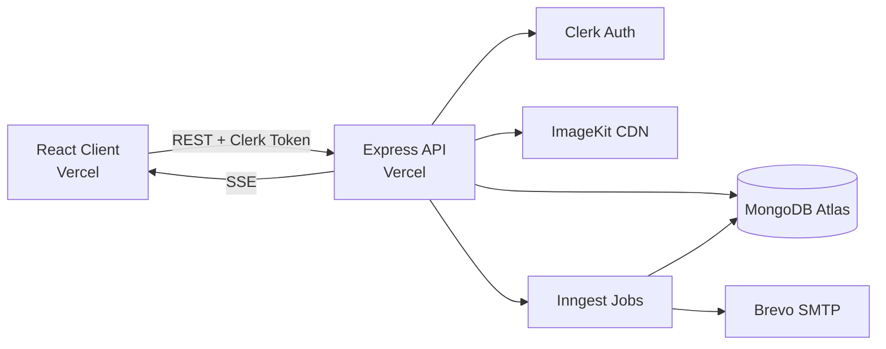

<div align="center">

# ⚙️ Ping Up — Backend API

**The scalable REST API powering the Ping Up social media platform**


[🌐 Live App](https://ping-up-omega-five.vercel.app) • [🚀 Live API](https://ping-up-server-one-eta.vercel.app) • [🎬 Watch Demo](YOUR_GOOGLE_DRIVE_VIDEO_LINK) • [🖥️ Frontend Repo](https://github.com/momen-tarek111/PingUp.git)

</div>

---

## 🎬 Demo Video

[](YOUR_GOOGLE_DRIVE_VIDEO_LINK)

## 🔗 Live Links

| Service | URL |
|---|---|
| 🌐 Frontend (React) | https://ping-up-omega-five.vercel.app |
| 🚀 Backend (API) | https://ping-up-server-one-eta.vercel.app |
| ⏱️ Inngest Endpoint | https://ping-up-server-one-eta.vercel.app/api/inngest |

---

## 📖 Overview

**Ping Up** is a full-featured social media platform built with the **MERN stack**.
This repository contains the **backend**: a secure, modular REST API that handles
authentication, posts, stories, connections, real-time messaging, media
optimization, and background jobs.

## ✨ Key Features

| Feature | Description |
|---|---|
| 🔐 **Authentication** | Secure sign-in, sign-up & profile management via **Clerk** |
| 📰 **Posts & Feed** | Create text/image posts, like, and view a personalized feed |
| 📸 **Stories** | Upload stories that automatically expire after 24 hours |
| 🤝 **Connections** | Follow / unfollow and manage friend requests |
| 💬 **Real-time Chat** | Instant messaging with text & image support |
| 🔎 **Discovery** | Search and discover new users |
| 🖼️ **Media Optimization** | Images stored and delivered through **ImageKit** |
| ⏱️ **Background Jobs** | Event-driven & scheduled tasks handled by **Inngest** |
| 📧 **Email Notifications** | Transactional emails via **Nodemailer** + Brevo SMTP |

## 🏗️ Architecture



## 🧰 Tech Stack

| Category | Technology | Version |
|---|---|---|
| Runtime | Node.js (ES Modules) | 20+ |
| Framework | Express.js | ^5.2 |
| Database | MongoDB + Mongoose | ^9.10 |
| Auth | Clerk (`@clerk/express`) | ^2.1 |
| Background Jobs | Inngest | ^4.21 |
| Media | ImageKit (`@imagekit/nodejs`) | ^7.12 |
| File Uploads | Multer | ^2.4 |
| Email | Nodemailer | ^10.0 |
| CORS / Env | cors, dotenv | ^2.8 / ^18 |
| Dev Tool | Nodemon | ^3.1 |

## 📁 Project Structure

```
server/
├── configs/        # DB, ImageKit, Multer, Nodemailer configs
├── controllers/    # Business logic (user, post, story, message)
├── inngest/        # Background jobs & scheduled functions
├── middlewares/    # Auth protection & error handling
├── models/         # Mongoose schemas
├── routes/         # API route definitions
└── server.js       # App entry point
```

## 🚀 Getting Started

### Prerequisites
- Node.js v20+
- MongoDB (local or Atlas)
- Accounts: Clerk, Inngest, ImageKit, Brevo (SMTP)

### Installation

```bash
git clone https://github.com/momen-tarek111/PingUp_Server.git
cd server
npm install
```

### Environment Variables

Create a `.env` file in the root (**never commit this file**):

```env
MONGODB_URL=your_mongodb_connection_string

CLERK_PUBLISHABLE_KEY=your_clerk_publishable_key
CLERK_SECRET_KEY=your_clerk_secret_key

INNGEST_EVENT_KEY=your_inngest_event_key
INNGEST_SIGNING_KEY=your_inngest_signing_key

IMAGEKIT_PUBLIC_KEY=your_imagekit_public_key
IMAGEKIT_PRIVATE_KEY=your_imagekit_private_key
IMAGEKIT_URL_ENDPOINT=your_imagekit_url_endpoint

SENDER_EMAIL=your_sender_email
SMTP_USER=your_smtp_user
SMTP_PASS=your_smtp_password

# Local: http://localhost:5173
# Production: https://ping-up-omega-five.vercel.app
FRONTEND_URL=http://localhost:5173
```

### Run

```bash
npm run server   # development (nodemon)
npm start        # production
```

## 📡 API Endpoints

> Protected routes require a valid Clerk session token.

### 👤 User
| Method | Endpoint | Description |
|---|---|---|
| GET | `/api/user/data` | Get current user data |
| POST | `/api/user/update` | Update profile |
| POST | `/api/user/discover` | Search users |
| POST | `/api/user/follow` | Follow a user |
| POST | `/api/user/unfollow` | Unfollow a user |
| POST | `/api/user/connect` | Send connection request |
| POST | `/api/user/accept` | Accept connection request |

### 📰 Posts & Stories
| Method | Endpoint | Description |
|---|---|---|
| POST | `/api/post/add` | Create a post |
| GET | `/api/post/feed` | Get feed |
| POST | `/api/post/like` | Like / unlike a post |
| POST | `/api/story/create` | Upload a story |
| GET | `/api/story/get` | Get active stories |

### 💬 Messages
| Method | Endpoint | Description |
|---|---|---|
| GET | `/api/message/:userId` | Real-time message stream (SSE) |
| POST | `/api/message/send` | Send a message |
| POST | `/api/message/get` | Get chat history |

**Base URL (production):** `https://ping-up-server-one-eta.vercel.app`

## ☁️ Deployment (Vercel)

1. Import the repo into **Vercel**
2. Add all environment variables from above in the project settings
3. Set `FRONTEND_URL` to `https://ping-up-omega-five.vercel.app`
4. Register `https://ping-up-server-one-eta.vercel.app/api/inngest` in the Inngest dashboard

## 🔒 Security

- Clerk-verified protected routes
- Environment-based secrets (never committed)
- Centralized error handling
- CORS configured for trusted origins

## 👨‍💻 Author

**Momen Tarek Nagaty**

[](https://www.linkedin.com/in/momen-tarek-nagaty)
[](https://github.com/momen-tarek111)
[](mailto:momen.tarek.nagaty@gmail.com)

---

<div align="center">⭐ If you like this project, give it a star! ⭐</div>